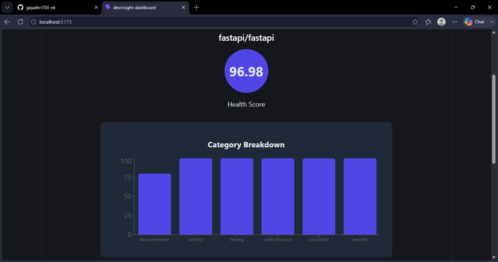
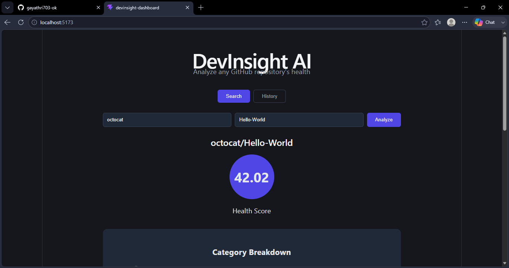
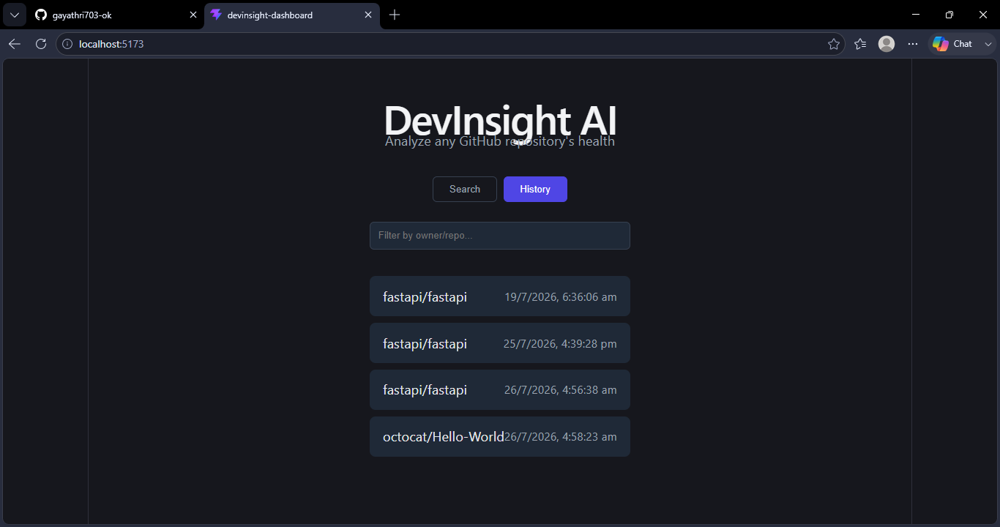
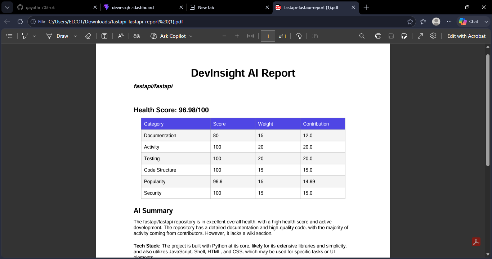
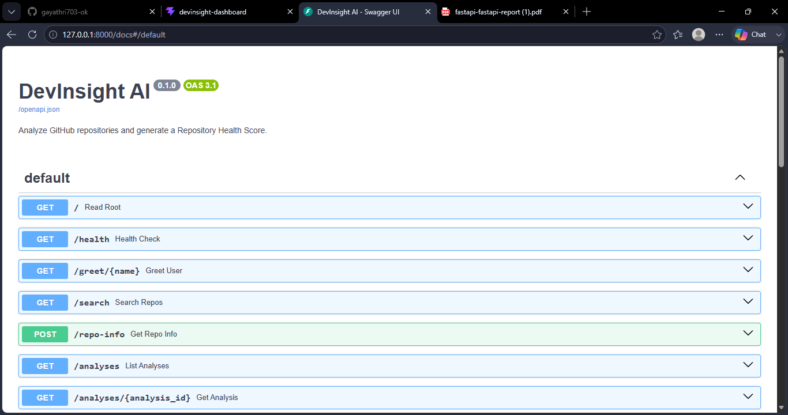
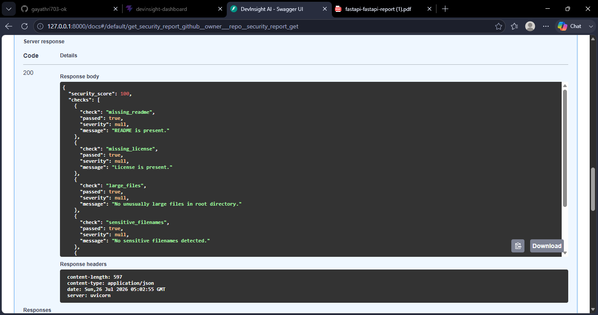

<div align="center">

# 🔍 DevInsight AI

### Know a repository's health before you clone it.

DevInsight AI turns any public GitHub repository into a **Repository Health Score** — backed by real activity data, code quality signals, security checks, and an AI-generated plain-English summary.

[**Live Demo**](https://devinsight-dashboard-flame.vercel.app/) · [**API Docs**](https://devinsight-ai-yw4y.onrender.com/docs) · [**Report a bug**](https://github.com/gayathri703-ok/devinsight-ai/issues)

[](https://github.com/gayathri703-ok)
[](https://www.linkedin.com/in/gayathri703)

</div>

---

## The problem

Before pulling in a dependency or evaluating an open-source project, you usually end up manually digging through commit history, checking for tests, hunting for a license, and guessing at how "alive" a repo really is. That's slow, subjective, and easy to get wrong.

**DevInsight AI automates that judgment call.** Paste in an `owner/repo`, and in seconds you get a scored, explained, and auditable answer.

## How it works

```
 You search "fastapi/fastapi"
        │
        ▼
 React dashboard  ──────▶  FastAPI backend
                                │
                ┌───────────────┼────────────────┐
                ▼                ▼                ▼
          GitHub REST API    Groq AI (LLM)    SQLite (history)
                │                │
        stars · commits    plain-English
        issues · files      summary +
        contributors        suggestions
                │                │
                └───────┬────────┘
                        ▼
              Weighted Health Score (0–100)
              + AI Summary + Security Report
                        │
                        ▼
          Dashboard · PDF export · History log
```

## What it actually scores

| Category | Weight | Real signal used |
|---|---|---|
| **Documentation** | 15% | README, LICENSE, and Wiki presence |
| **Activity** | 20% | Days since last commit, recent commit volume, contributor count |
| **Testing** | 20% | Presence of a tests folder and CI configuration |
| **Code Structure** | 15% | Lint config and dependency/package files |
| **Popularity** | 15% | Stars, forks, watchers — scaled logarithmically, not linearly |
| **Security** | 15% | Missing docs, oversized files, risky filenames, regex-based secret scanning |

Each category is computed from **live GitHub data**, not estimated. Security findings are deducted from 100 by severity (`critical` → `low`), so an exposed API key hurts the score far more than a missing license.

### Proof it actually discriminates

| Repository | Health Score | Why |
|---|---|---|
| `fastapi/fastapi` | **~90–97** | Commits within days, full CI/test coverage, 100k+ stars |
| `octocat/Hello-World` | **~35–42** | Last commit 14+ years ago, zero tests, no license |

## Screenshots

**Analyzing a healthy, actively maintained repository**


**Analyzing an inactive repository — the score correctly drops**


**Searchable history of past analyses, backed by SQLite**


**One-click downloadable PDF report**


**Full interactive API documentation**


**Security findings, with severity-based scoring**


## Tech stack

| Layer | Choice | Why |
|---|---|---|
| Backend | FastAPI, Python | Async-friendly, auto-generated docs, strong typing via Pydantic |
| Database | SQLite + SQLAlchemy | Zero-config for a single-instance deployment; swappable to Postgres via one env var |
| AI | Groq (Llama 3.1), OpenAI-compatible client | Free tier, and the provider is swappable behind one service module |
| Frontend | React + Vite, Recharts | Fast dev loop, lightweight charting |
| Reports | ReportLab | In-memory PDF generation, no temp files on disk |
| Testing | pytest | Automated verification of the scoring engine's math |
| Deployment | Render (API) · Vercel (dashboard) | Free tier, git-based deploys |

## API reference (selected)

| Method | Endpoint | Returns |
|---|---|---|
| `GET` | `/analyze/{owner}/{repo}` | Full health score, category breakdown, AI summary |
| `GET` | `/analyze/{owner}/{repo}/pdf` | Downloadable PDF version of the above |
| `GET` | `/github/{owner}/{repo}/security-report` | Security score and individual findings |
| `GET` | `/analyses` | History of every repository analyzed so far |

Full interactive documentation: **[/docs](https://devinsight-ai-yw4y.onrender.com/docs)**

## Run it locally

**Backend**
```bash
git clone https://github.com/gayathri703-ok/devinsight-ai.git
cd devinsight-ai
python3 -m venv venv
source venv/bin/activate        # Windows: venv\Scripts\activate
pip install -r requirements.txt
cp .env.example .env            # add your own GitHub token + Groq API key
uvicorn app.main:app --reload
```

**Frontend**
```bash
git clone https://github.com/gayathri703-ok/devinsight-dashboard.git
cd devinsight-dashboard
npm install
npm run dev
```

Dashboard: `http://localhost:5173` · API docs: `http://localhost:8000/docs`

## Engineering decisions worth asking about

- **Why a weighted score instead of a pass/fail checklist?** Some signals (like recent activity) matter more than others (like having a wiki). A flat checklist can't express that; a weighted score can.
- **Why logarithmic scaling for popularity?** The jump from 50 to 500 stars matters far more than 50,000 to 50,500. Linear scaling would treat both identically.
- **Why is the AI provider swappable?** The AI logic lives entirely behind one service module. Switching from OpenAI to Groq took changing a base URL and model name — nothing else in the codebase changed.
- **Why in-memory caching instead of Redis?** This is a single-instance deployment; a dictionary with a TTL solves the actual problem without adding infrastructure that isn't needed yet.

## Roadmap

- Recursive secret scanning across the full file tree, not just root-level config files
- Redis-backed caching for multi-instance deployments
- Support for GitLab and Bitbucket repositories
- Saved, shareable comparison reports between two repositories

---

<div align="center">

Built by **Gayathri** as a full-stack portfolio project demonstrating backend engineering, third-party API integration, applied AI/LLM usage, and production deployment.

[GitHub](https://github.com/gayathri703-ok) · [LinkedIn](https://www.linkedin.com/in/gayathri703)

</div>